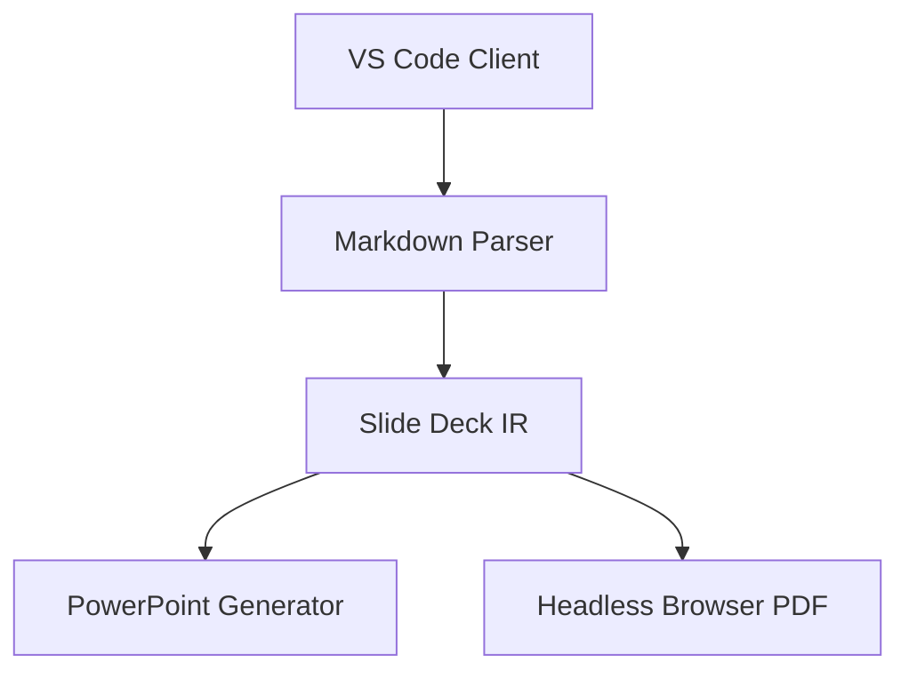

# md-tech-slide

English | [日本語](README.ja.md)

A Visual Studio Code extension and presentation engine that transforms Markdown documents into native Microsoft PowerPoint (`.pptx`) presentations and high-resolution vector PDF slide decks with flexible multi-column layouts and offline Mermaid diagram rendering.

## Features

- Native PowerPoint (.pptx) Export: Generates genuine Microsoft PowerPoint presentations with editable native shapes, text boxes, tables, and speaker notes.
- High-Resolution PDF Export: Prints lossless vector slides via headless Chrome / Edge or Chrome for Testing.
- Interactive Live Preview: Custom Webview slide preview with real-time bidirectional scroll synchronization.
- Multi-Column Layouts: Flexible column directives (`::: columns ratio="2:1"`) with customizable width ratios.
- Offline Mermaid Diagrams: Full support for Flowcharts, Sequence, Class, State, and ER diagrams embedded as vector SVGs without external network calls.
- Rich Typography Control: Simple or granular role-based font and size settings in Frontmatter with Japanese typography support.
- Real-Time Overflow Diagnostics: Visual editor warnings when slide content exceeds standard slide boundaries.

## System Requirements

- Visual Studio Code: Version `^1.101.0` or higher
- Node.js Runtime: Version `>=22.12.0` (Node.js 20 is not supported)
- Supported Operating Systems: macOS, Windows, Linux
- PDF Export Browser: Google Chrome, Microsoft Edge, Brave, Chromium, or pre-installed Chrome for Testing.

## Installation

### Manual VSIX Installation

Download the latest `.vsix` package from GitHub Releases and install it via the terminal:

```bash
code --install-extension md-tech-slide-0.1.0.vsix
```

Alternatively, install through the VS Code UI:

1. Open the Extensions view (`Ctrl+Shift+X` or `Cmd+Shift+X`).
2. Click the Views and More Actions menu (`...`) at the top-right corner.
3. Select Install from VSIX... and pick the downloaded package.

## Markdown Syntax Guide

Slides are separated by `########` delimiters (8 hashes) or horizontal rules `---` (outside Frontmatter).

### Frontmatter Configuration Reference

Add YAML metadata at the top of your Markdown file:

```yaml
---
title: 'Technical Presentation'
author: 'Engineering Team'
theme: 'corporate'
aspectRatio: '16:9'
paginate: true
font: 'Noto Sans JP'
codeFont: 'Cascadia Code'
---
```

#### Complete Frontmatter Keys

| Key                  | Type      | Default       | Description & Constraints                                                                  |
| -------------------- | --------- | ------------- | ------------------------------------------------------------------------------------------ |
| `title`              | `string`  | `""`          | Document and title slide title. Max 256 characters.                                        |
| `author`             | `string`  | `""`          | Presenter or organization name. Max 128 characters.                                        |
| `theme`              | `string`  | `"default"`   | Slide color theme. Options: `default`, `corporate`, `dark`.                                |
| `aspectRatio`        | `string`  | `"16:9"`      | Slide dimensions. Options: `16:9` (10x5.625 in), `4:3` (10x7.5 in).                        |
| `paginate`           | `boolean` | `true`        | Show or hide slide page numbers in footer.                                                 |
| `font`               | `string`  | Theme default | Simple font setting applied to headings and body text. Max 128 chars; `<>{};` not allowed. |
| `codeFont`           | `string`  | Theme default | Monospace font for code blocks and inline code. Max 128 chars.                             |
| `fonts.body`         | `string`  | Theme default | Granular body font family.                                                                 |
| `fonts.heading`      | `string`  | Theme default | Granular slide heading font family.                                                        |
| `fonts.code`         | `string`  | Theme default | Granular code font family.                                                                 |
| `fontSize.body`      | `number`  | Theme default | Granular body text font size in points (`8` - `96`).                                       |
| `fontSize.heading`   | `number`  | Theme default | Granular heading font size in points (`8` - `96`).                                         |
| `fontSize` (numeric) | `number`  | -             | Deprecated legacy base size (`8` - `96`). Emits diagnostic warning.                        |
| `fontFamily`         | `string`  | -             | Deprecated legacy font family. Emits diagnostic warning.                                   |

### Typography Precedence & Font Substitution

1. Resolution Precedence:
   `fonts.*` / `fontSize.*` > `font` / `codeFont` > `fontFamily` / numeric `fontSize` > Theme Defaults > System Fallbacks.
2. PowerPoint Font Embedding:
   During PPTX generation, font names are synchronously assigned to both `a:latin` and `a:ea` (East Asian) attributes.
3. System Font Substitution:
   If a specified font is not installed on the system viewing the presentation, PowerPoint and browsers will substitute their respective system fallback fonts. Ensure standard cross-platform fonts are used when sharing presentations.

### Multi-Column Layout

Use `::: columns` and `::: column` directives:

```markdown
::: columns ratio="2:1"
::: column

### Left Column (Main)

- Primary architectural descriptions
- Component responsibilities

:::
::: column

### Right Column (Side)


:::
:::
```

Supported `ratio` formats: `1:1`, `2:1`, `1:2`, `1:1:1`, `1:2:1`.

### Mermaid Diagrams

Fenced code blocks with `mermaid` syntax are rendered offline into vector SVGs:

````markdown

````

Supported diagram types: Flowcharts, Sequence diagrams, Class diagrams, State diagrams, and ER diagrams.
Diagrams are rendered completely offline using the bundled `dist/mermaid-renderer.js`.

### Tables and Code Blocks

Native Markdown tables are converted into editable PowerPoint table shapes:

```markdown
| Component | Responsibility        | Status |
| --------- | --------------------- | ------ |
| Parser    | Slide IR Generation   | Active |
| Exporter  | PPTX & PDF Generation | Active |
```

Code blocks feature syntax highlighting with Shiki:

```typescript
export interface SlideDeck {
  readonly slides: readonly Slide[];
}
```

### Speaker Notes

Use `::: note` directives to add speaker notes:

```markdown
::: note
Presenter talking points:

- Emphasize offline capability.
- Highlight dual Latin / East Asian font binding.
  :::
```

In PowerPoint, notes are placed in the native slide speaker notes pane.

## PowerPoint & PDF Export Characteristics

### Editable PowerPoint Elements

- Text Boxes & Headings: Fully editable text shapes with scalable font sizes.
- Tables: Native table objects with editable text and cells.
- Bullet Lists: Native list shapes with indent levels.
- Speaker Notes: Native PowerPoint speaker notes.

### Non-Editable PowerPoint Constraints

- Mermaid Diagrams: Inserted as native vector SVG images (`ppt/media/*.svg`). Text inside diagrams cannot be edited as PowerPoint text boxes.
- Images: Placed as picture shapes.
- Code Blocks: Highlighted text runs inside native rectangle shapes.

## Browser Detection for PDF Export

When exporting to PDF, `md-tech-slide` locates a Chromium-based browser in the following order:

1. Custom Browser Path: Set via VS Code configuration `mdTechSlide.export.browserPath`.
2. System Browser Auto-Detection: Scans standard OS installation directories for Google Chrome, Microsoft Edge, Brave, or Chromium.
3. Pre-installed Testing Browser: In automated CI test environments, uses bundled Chrome for Testing.

If no compatible browser is found, an actionable error notification prompts you to install Chrome/Edge or configure `mdTechSlide.export.browserPath`.

## Extension Settings

| Setting                          | Type     | Default     | Description                                                  |
| -------------------------------- | -------- | ----------- | ------------------------------------------------------------ |
| `mdTechSlide.defaultTheme`       | `string` | `"default"` | Default presentation theme (`default`, `corporate`, `dark`). |
| `mdTechSlide.defaultAspectRatio` | `string` | `"16:9"`    | Default presentation aspect ratio (`16:9`, `4:3`).           |
| `mdTechSlide.export.browserPath` | `string` | `""`        | Custom executable path for Google Chrome or Microsoft Edge.  |

## Available Commands

- `md-tech-slide.openPreview`: md-tech-slide: Open Slide Preview
- `md-tech-slide.exportPPTX`: md-tech-slide: Export to PowerPoint (PPTX)
- `md-tech-slide.exportPDF`: md-tech-slide: Export to PDF Slide

## License

This project is licensed under the [MIT License](LICENSE).
Third-party software licenses are documented in [THIRD_PARTY_LICENSES.txt](THIRD_PARTY_LICENSES.txt).
